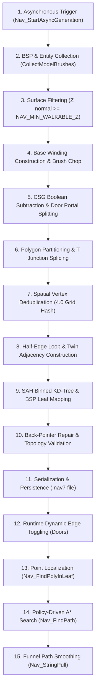

# Half-Edge Mesh Navigation System: Technical Architecture & Process (A to Z)

## Executive Summary

This document presents the complete technical architecture and end-to-end operational workflow of the **Half-Edge Mesh Navigation System** in `Q2RTXPerimental`.

The navigation pipeline extracts walkable floor geometry directly from the map's BSP collision model (`cm_t`), builds a 3D half-edge topological mesh with height-delta edge linking, constructs an acceleration KD-Tree and BSP leaf lookup table, dynamically handles interactive entities (e.g., doors and walls), and executes constrained A* pathfinding coupled with Funnel (string-pulling) path smoothing.

---

## System Overview & Core Data Structures

The system architecture is split into three primary layers:
1. **Offline/Async Generation**: BSP geometry extraction, CSG boolean subtraction, half-edge topology generation, KD-Tree partitioning, and `.nav7` binary serialization.
2. **Runtime Spatial Queries & Localization**: BSP leaf mapping and KD-Tree traversal for $O(\log N)$ / $O(1)$ face localization.
3. **Pathfinding & Steering Execution**: Policy-driven A* search across half-edge face loops, dynamic edge state toggling (doors), and Funnel path smoothing.

```
 +------------------------+     +------------------------+     +------------------------+
 |    BSP Collision       | --> |   Planar Extraction    | --> |     CSG Subtraction    |
 |    Model (cm_t)        |     |   & Surface Filtering  |     |   (Solid Brush Clip)   |
 +------------------------+     +------------------------+     +------------------------+
                                                                            |
 +------------------------+     +------------------------+                  v
 |   A* Pathfinding &     | <-- |   KD-Tree & BSP Leaf   | <-- +------------------------+
 |  Funnel String-Pulling |     |    Spatial Indexes     |     |   Half-Edge Mesh &     |
 +------------------------+     +------------------------+     |   Twin Edge Linking    |
                                                               +------------------------+
```

### Primary Data Structures (`nav_types.h`)

*   **`nav_poly_t`**: Raw convex polygon winding extracted from a BSP surface plane.
*   **`g_nav_vertices` (`std::vector<Vector3DP>`)**: Globally deduplicated array of 3D vertex coordinates.
*   **`nav_halfedge_t`**: Directed edge record containing:
    *   `vertex_idx`: Index of origin vertex in `g_nav_vertices`.
    *   `twin_idx`: Index of the opposite half-edge in an adjacent face (or `-1` for outer boundaries).
    *   `next_idx`: Index of the next half-edge in the face loop.
    *   `face_idx`: Index of the owning face in `g_nav_faces`.
    *   `z_diff`: Vertical height difference between this edge and its twin edge (enables continuous stair/step/drop traversal).
    *   `edge_entity_id`: Entity ID of dynamic geometry (e.g., a door portal), or `ENTITYNUM_NONE`.
    *   `flags`: Bitmask controlling runtime traversal (e.g., `NAV_EDGE_DISABLED` for closed doors).
*   **`nav_face_t`**: Polygon face record containing:
    *   `face_id`: Unique identifier assigned after KD-Tree face sorting.
    *   `first_edge_idx`: Index of the starting half-edge in `g_nav_halfedges`.
    *   `num_edges`: Total count of half-edges defining the face perimeter.
    *   `center` / `normal`: Double-precision 3D centroid and plane normal.
    *   `clearance`: Minimum distance from centroid to face perimeter.
    *   `bsp_leaf_id` / `entity_id` / `transition_entity_id`: Spatial ownership and door transition metadata.
*   **`nav_kdtree_node_t`**: Bounding-box node (`mins`, `maxs`) storing split axis, child indices (`left_child`, `right_child`), or leaf face spans (`first_face_id`, `num_faces`).
*   **`nav_leaf_link_t`**: Direct mapping connecting BSP leaf IDs to face ID spans for $O(1)$ spatial candidate lookups.

---

## Comprehensive Process Workflow (A to Z)



---

### Step 1: Asynchronous Trigger & Thread Initialization

*   **Trigger**: NavMesh generation is initiated via console command `Nav_GenerateCommand()`, which calls `Nav_StartAsyncGeneration()`.
*   **Background Worker Thread**: `Nav_AsyncWorkerThread` (`nav_thread.cpp`) spawns a dedicated worker thread to process extraction without halting or stuttering the main game loop at 60+ FPS.
*   **Status Polling**: Progress is tracked safely via `Nav_StatusCommand()`.

---

### Step 2: BSP Model & Active Entity Geometry Harvesting

*   **Source Data**: Accesses the global collision model (`cm_t`) and BSP cache (`bsp_t`).
*   **World Brushes**: Traverses the static world BSP model (`bsp->models[0]`).
*   **Submodel Entities**: Scans active edicts (`g_edicts`) for inline bmodels (`*1`, `*2`, etc.), such as walkable platform walls (`svg_func_wall_t`) and horizontal drawbridges/trapdoors (`svg_func_door_rotating_t`).
*   **Door Geometry Exemption**: Regular physical door brush geometry (`svg_func_door_t`) is intentionally **exempted** from static floor generation so it does not carve permanent holes into the floor. Door boundaries are instead tagged dynamically onto natural floor seam portals.
*   **Excluded Brushes (`CONTENTS_NO_NAVMESH`)**: Any brush tagged with `CONTENTS_NO_NAVMESH` (in world or entity submodels) is completely omitted during collection and extraction, guaranteeing it does not generate floors or subtract from other geometry.

---

### Step 3: Walkable Surface Filtering

For every candidate brush side:
1.  **Brush Contents Check**: Brushes must possess `CONTENTS_SOLID`, `CONTENTS_DETAIL`, or `CONTENTS_MONSTERCLIP`, and must not possess `CONTENTS_NO_NAVMESH`. Helper origin brushes (`IsOriginBrush`) are ignored.
2.  **Sky & Excluded Surface Check**: Surfaces tagged with `CM_SURFACE_FLAG_SKY` or `CM_SURFACE_NO_NAVMESH` are immediately discarded.
3.  **Slope / Normal Angle Threshold**: Surface normals are evaluated. Only planes with a vertical Z normal matching or exceeding `NAV_MIN_WALKABLE_Z` ($0.65$, corresponding to a maximum walkable incline of $\approx 49.46^\circ$) are accepted as walkable floors:
    $$\text{normal.z} \ge 0.65$$

---

### Step 4: Base Winding Construction & Volume Chopping

1.  **Plane Transformation**: Transforms authored brush planes into world space using entity translation and rotation offsets.
2.  **Base Winding Creation**: Creates a massive bounding polygon winding (`BaseWindingForPlane`) aligned to the surface plane.
3.  **In-Place Volume Chopping**: Clips the winding against all other bounding planes of the parent brush (`ChopWindingInPlace`). The resulting convex polygon perfectly matches the top face of the brush volume.

---

### Step 5: CSG Boolean Subtraction & Dynamic Door Footprint Splitting

1.  **Solid CSG Subtraction**: The candidate floor polygon is clipped against all intersecting solid/blocking brushes (e.g., pillars, walls, structural supports). Any portion covered by a solid volume is carved out.
2.  **Stair Step Preservation**: Low ascending steps ($z \le \text{NAV\_MAX\_STEP\_HEIGHT} = 18.25\text{ units}$) are protected from being completely swallowed so stair treads remain valid walkable surfaces.
3.  **Dynamic Door Footprint Splitting**: Door transition volumes cut the floor polygon into distinct regions: standard world floor faces and transition portal faces tagged with `transition_entity_id`.

---

### Step 6: Polygon Sub-Partitioning & T-Junction Splicing

1.  **Convex Sub-Partitioning**: `Nav_PartitionPolygons()` subdivides large floor polygons into smaller, well-conditioned convex N-gons.
2.  **Portal Alignment**: `Nav_ResolveDynamicPortalTJunctions()` aligns edge boundaries between dynamic door portals and adjacent world floor faces.
3.  **T-Junction Edge Splicing**: `Nav_ResolveTJunctionsByEdgeSplicing()` detects collinear edges meeting at T-junction vertices and inserts split vertices onto adjacent edges, ensuring strict conformal geometry across polygon shared boundaries.

---

### Step 7: Spatial Vertex Deduplication & Grid Hashing

1.  **Spatial Hash Grid**: Vertices are inserted into a spatial hash grid with a cell resolution of $4.0\text{ units}$ (`GRID_SIZE = 4.0`).
2.  **Floating-Point Epsilon Matching**: Neighboring grid cells are searched using a strict distance squared threshold:
    $$\Delta x^2 + \Delta y^2 + \Delta z^2 < 0.000001$$
    This eliminates duplicate vertex coordinates caused by floating-point rounding while preventing "canonical vertex drift" across staircases.
3.  **Global Vertex Indexing**: Unique 3D points are stored in `g_nav_vertices`, returning a unique integer index (`vertex_idx`).

---

### Step 8: Half-Edge Loop & Twin Adjacency Construction

For every sub-partitioned polygon face $i$:
1.  **Half-Edge Allocation**: Creates a `nav_halfedge_t` for each polygon edge, setting `vertex_idx`, `face_idx = i`, and `next_idx` pointing to the next edge in the winding loop.
2.  **Face Clearance Calculation**: Computes `face.clearance` as the shortest perpendicular 3D distance from the face centroid to any of its perimeter edges.
3.  **Twin Edge Matching**: Scans edge pairs across faces. An edge $A \to B$ in face 1 is linked as twin to edge $B \to A$ in face 2 (`twin_idx` bidirectional assignment).
4.  **Vertical Height Delta (`z_diff`) Calculation**: For twin pairs, records the vertical Z height difference:
    $$z\_diff = \text{vertex\_B.z} - \text{vertex\_A.z}$$
    This height delta allows pathfinding algorithms to evaluate whether a transition between two faces represents a level move, an upward step, or a downward drop.
5.  **Boundary Edges**: Perimeter edges without a twin retain `twin_idx = -1` and record a default wall clearance offset (`wall_offset = 16.0`).

---

### Step 9: SAH Binned KD-Tree Construction & BSP Leaf Mapping

1.  **Binned SAH Spatial Partitioning**: `BuildKDNode()` recursively constructs a 3D KD-Tree (`g_nav_nodes`) using the Surface Area Heuristic (SAH) with 1024 bins (`KDTREE_MAX_BIN` = 1024) across the X, Y, and Z axes.
2.  **Splitting Termination**: Splitting continues until a leaf node contains $\le 32$ faces (`MAX_FACES_PER_LEAF = 32`) or maximum tree depth is reached.
3.  **Face Array Shuffling**: During KD-Tree construction, `std::partition` physically reorders the elements in `g_nav_faces` so that faces within each leaf node occupy a contiguous array span.
4.  **BSP Leaf Link Table**: Creates `g_nav_leaf_links` and `g_nav_leaf_poly_ids`, mapping BSP leaf IDs directly to contiguous face spans for $O(1)$ local candidate lookups.

---

### Step 10: Back-Pointer Repair & Topology Validation

1.  **Face Back-Pointer Update**: Because `std::partition` shuffled `g_nav_faces`, `Nav_BuildKDTree()` iterates through all faces and updates every half-edge's `face_idx` back-pointer to point to its new face index.
2.  **Topology Invariant Verification**: `Nav_ValidateTopology("KDTree")` verifies:
    *   Valid half-edge face back-pointers.
    *   Symmetric twin linking (`g_nav_halfedges[he.twin_idx].twin_idx == he_idx`).
    *   Valid vertex indices and closed face loops.

---

### Step 11: Binary Serialization & Persistence (`.nav7`)

1.  **Magic Header Validation**: Stores a `nav_header_t` with `NAV7_MAGIC` (`0x4E415637`), `NAV7_VERSION`, and the map's BSP CRC checksum (`map_checksum`).
2.  **Flat Array Dump**: Serializes `g_nav_vertices`, `g_nav_halfedges`, `g_nav_faces`, `g_nav_nodes`, `g_nav_leaf_links`, and `g_nav_leaf_poly_ids` to disk.
3.  **Fast Boot Loading**: On subsequent map loads, `nav_persistence.cpp` verifies the checksum and loads the cached `.nav7` file directly into memory in milliseconds.

---

### Step 12: Dynamic Runtime Edge Management (Doors & Interactive Obstacles)

```
 [Closed Door Entity]  --> Nav_SetEntityEdgesState(entity_id, NAV_EDGE_DISABLED, true)
                           => Half-edges tagged with NAV_EDGE_DISABLED
                           => A* Pathfinder rejects edge traversal

 [Opened Door Entity]  --> Nav_SetEntityEdgesState(entity_id, NAV_EDGE_DISABLED, false)
                           => NAV_EDGE_DISABLED cleared from half-edges
                           => A* Pathfinder permits seamless traversal
```

*   **Dynamic Registration**: Half-edges bordering interactive entities store `edge_entity_id`. `g_nav_entity_edges` maintains an $O(1)$ lookup table mapping entity IDs to list of half-edge indices.
*   **Door State Toggling**:
    *   When a door closes, the server executes `Nav_SetEntityEdgesState(door_ent_id, NAV_EDGE_DISABLED, true)`.
    *   When a door opens, `NAV_EDGE_DISABLED` is cleared.
*   **A* Pathfinder Integration**: During A* expansion, edges marked with `NAV_EDGE_DISABLED` are immediately rejected unless the query policy explicitly sets `ignore_disabled_edges = true`.

---

### Step 13: Point Localization & Spatial Queries

Before finding a path, 3D entity positions must be mapped to face IDs:
1.  **`Nav_FindPolyInLeaf(Vector3 point)`**:
    *   Walks the KD-Tree in $O(\log N)$ time (`Nav_FindLeafNode`) to find the bounding leaf node containing `point`.
    *   Iterates through faces in that leaf and runs a 2D point-in-polygon projection test (`Nav_PointInsideFace2D`).
    *   Checks if the point's vertical distance to the face plane falls within valid step bounds.
2.  **`Nav_FindClosestPolyGlobal(Vector3 point)`**: Fallback query that scans all global faces by 3D distance if an entity is off-mesh.

---

### Step 14: Policy-Driven A* Path Search

`Nav_FindPath(startFace, goalFace, outPath, policy)` executes A* graph search:
1.  **Policy Parameters (`nav_path_policy_t`)**:
    *   `max_step_height`: Maximum upward step height allowed (default: `18.25` units).
    *   `max_drop_height`: Maximum downward drop height allowed (default: `128.0` units).
    *   `agent_radius`: Clearance radius required for traversal (default: `16.0` units).
    *   `min_portal_width`: Minimum shared portal width required.
    *   `allow_gap_jumping` / `max_jump_distance`: Capability to jump across disconnected faces.
2.  **Priority Queue Expansion**:
    *   F-score evaluation: $f(n) = g(n) + h(n)$, where $h(n)$ is the 3D Euclidean distance from face centroid to target face centroid.
3.  **Neighbor Validation & Rejection Diagnostics**:
    *   For current face $F$, iterates over all half-edges.
    *   Rejects edges with `twin_idx == -1` (outer walls).
    *   Rejects edges with `NAV_EDGE_DISABLED` (closed doors).
    *   Validates vertical step/drop delta `z_diff` against policy thresholds (`max_step_height`, `max_drop_height`).
    *   Validates portal opening width against `agent_radius`.
4.  **Path Sequence Result**: Returns an ordered list of face IDs (`std::vector<int32_t>`) representing the optimal face corridor. Detailed failure causes are recorded in `nav_path_diagnostics_t`.

---

### Step 15: Path Smoothing & Steering — Funnel Algorithm

```
  Raw Face Corridor Path                    Smoothed 3D Waypoints (String-Pulling)
  +---------+---------+---------+           Start
  | Face 1  | Face 2  | Face 3  |             \
  |   *---> |   *---> |   *     |     ===>     \ (Funnel Left/Right Apex Tightening)
  +---------+---------+---------+               \
                                                 Goal
```

1.  **Portal Extraction (`Nav_GetPortalEndpoints`)**: For each transition between consecutive faces $F_k \to F_{k+1}$, retrieves the 3D portal segment endpoints ($V_0, V_1$).
2.  **Agent Clearance Inset**: Insets portal endpoints inward by `agent_radius` to prevent AI entities from clipping wall corners.
3.  **Funnel (String-Pulling) Algorithm (`Nav_StringPull`)**:
    *   Maintains a 3D funnel defined by a Left Apex ray and Right Apex ray starting from the current position.
    *   As it iterates through portal endpoints, it tightens the funnel rays.
    *   When a new portal endpoint crosses over the opposite funnel ray, the apex is updated, a new 3D waypoint is emitted, and the funnel restarts from that corner.
4.  **Forced Stair/Step Waypoints**: Preserves forced waypoints at stair landings to prevent AI path smoothing from cutting through stair risers.
5.  **Output**: Returns a clean list of 3D steerable waypoints (`std::vector<Vector3> outWaypoints`) ready for entity movement steering.

---

## File Reference Map

| Component / Phase | Source Files | Key Functions & Structures |
| :--- | :--- | :--- |
| **Types & Data Structures** | [`nav_types.h`](file:///d:/Dev/Projects/Q2RTXPerimental/code/src/baseq2rtxp/svgame/nav/nav_types.h) | `nav_poly_t`, `nav_halfedge_t`, `nav_face_t`, `nav_kdtree_node_t`, `nav_leaf_link_t` |
| **Thread & Async Control** | [`nav_thread.cpp`](file:///d:/Dev/Projects/Q2RTXPerimental/code/src/baseq2rtxp/svgame/nav/nav_thread.cpp) | `Nav_StartAsyncGeneration()`, `Nav_AsyncWorkerThread()` |
| **Geometry Extraction & CSG** | [`nav_generate.cpp`](file:///d:/Dev/Projects/Q2RTXPerimental/code/src/baseq2rtxp/svgame/nav/nav_generate.cpp) | `Nav_DoExtractionWork()`, `CollectModelBrushes()`, `ChopWindingInPlace()` |
| **Topology & Half-Edge Mesh** | [`nav_generate.cpp`](file:///d:/Dev/Projects/Q2RTXPerimental/code/src/baseq2rtxp/svgame/nav/nav_generate.cpp) | `Nav_BuildHalfEdgeMesh()`, `Nav_PartitionPolygons()`, `Nav_ResolveTJunctionsByEdgeSplicing()` |
| **KD-Tree & Leaf Mapping** | [`nav_generate.cpp`](file:///d:/Dev/Projects/Q2RTXPerimental/code/src/baseq2rtxp/svgame/nav/nav_generate.cpp) | `Nav_BuildKDTree()`, `BuildKDNode()`, `Nav_ValidateTopology()` |
| **Persistence & I/O** | [`nav_persistence.cpp`](file:///d:/Dev/Projects/Q2RTXPerimental/code/src/baseq2rtxp/svgame/nav/nav_persistence.cpp) | `Nav_SaveNavMesh()`, `Nav_LoadNavMesh()`, `NAV7_MAGIC` |
| **Localization & Queries** | [`nav_path.cpp`](file:///d:/Dev/Projects/Q2RTXPerimental/code/src/baseq2rtxp/svgame/nav/nav_path.cpp) | `Nav_FindPolyInLeaf()`, `Nav_FindLeafNode()`, `Nav_FindClosestPolyGlobal()` |
| **A* Pathfinding & Policy** | [`nav_path.cpp`](file:///d:/Dev/Projects/Q2RTXPerimental/code/src/baseq2rtxp/svgame/nav/nav_path.cpp) | `Nav_FindPath()`, `nav_path_policy_t`, `nav_path_diagnostics_t` |
| **Funnel Path Smoothing** | [`nav_path.cpp`](file:///d:/Dev/Projects/Q2RTXPerimental/code/src/baseq2rtxp/svgame/nav/nav_path.cpp) | `Nav_StringPull()`, `Nav_GetPortalEndpoints()` |
| **Dynamic Door Management** | [`nav_path.cpp`](file:///d:/Dev/Projects/Q2RTXPerimental/code/src/baseq2rtxp/svgame/nav/nav_path.cpp) | `Nav_SetEntityEdgesState()`, `Nav_ResyncDynamicEntityEdges()` |
